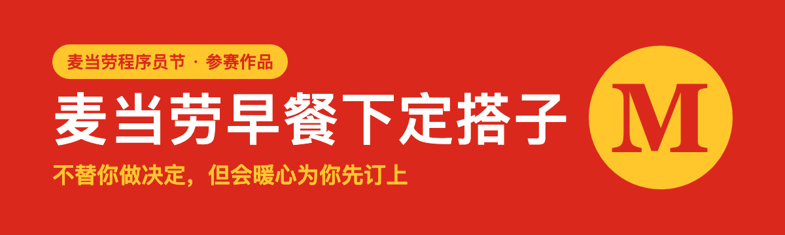
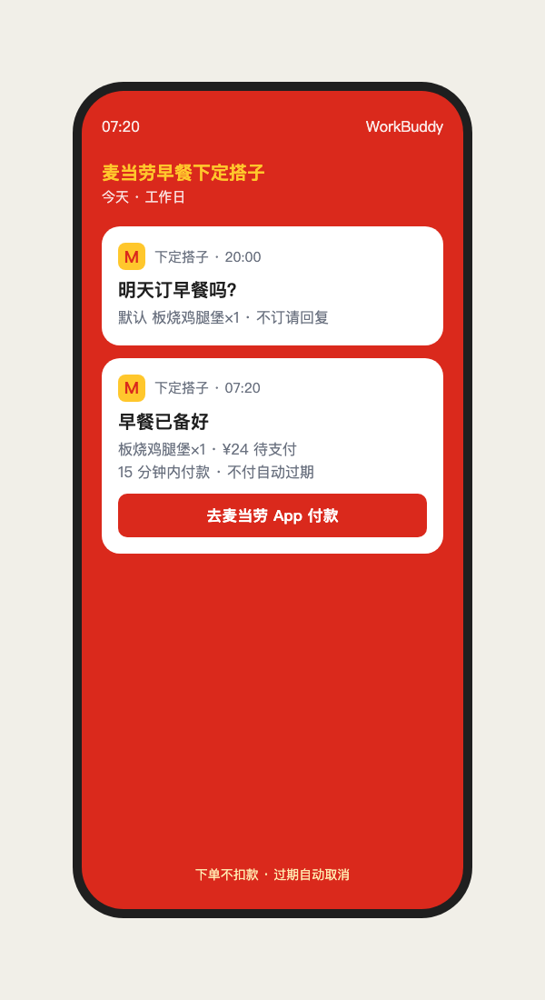
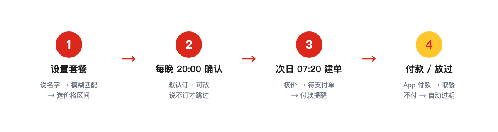

> **不替你做决定，但会暖心为你先订上；吃不吃，由你决定。**

一个会替你「惦记早餐」的小搭子。根据你的喜好，每天在固定时间把早餐单先建好、提醒你付款，再邀请你好好吃一顿早饭。你不必每天纠结——它先替你订上，你只管决定吃不吃。

<p>
  
  
</p>

## 核心理念

- **根据你的喜好**：你只说想吃什么（如"板烧""豆浆""吉士"），它模糊匹配门店餐品、按你选的价格区间帮你定好；
- **每日替你下定**：到点用麦当劳官方 MCP 把早餐单建好（「待支付」）；
- **提醒你支付**：推一条付款提醒，你点开麦当劳 App 付一下就行；
- **邀请你好好吃早餐**：每天附一句「麦言麦语」，提醒你照顾自己。
- **不替你做决定**：不付款、不扣款；不想吃就不付，订单 **15 分钟自动过期**。
- **但会暖心先订上**：默认替你订好；只有你明确说"不订/取消"，才跳过。

一句话：**决定权在你，备好的那份在我。**

## 麦言麦语

每天一句富有哲理的祝福，**和付款提醒一起推送**。例如：

> 早餐的温度，决定一天的态度。
>
> 别急着成为谁，先好好吃顿早饭。
>
> 你负责出发，我负责把热的那份备好。

（内置 **300 句**原创箴言，按日期确定性选取：同一天看到的是同一句。）

## 每天为你做的三件事

| | 做什么 | 什么时候 |
|---|---|---|
| 下定 | 建好「待支付」早餐单 | 次日 07:20 |
| 提醒 | 推付款提醒 + 一句麦言麦语 | 建单后 |
| 邀请 | 好好吃早餐，再出发 | 每一天 |



## 工作流程

```
① 首次设置：说个名字（如"板烧"）→ 模糊匹配 → 选价格区间 → 定套餐
② 每晚 20:00：问"明天订不订"（可改；不回答 = 默认订；说不订才跳过）
③ 次日 07:20：核价 → 建「待支付」单 → 推付款提醒 + 麦言麦语
④ 你付款：App 我的订单 → 付款 → 到店取餐
   （不付也不扣钱，15 分钟自动过期 = 自动取消）
```



## 诚实边界

麦当劳 MCP **没有预约/定时下单接口**，也**不能代付**。所以本项目的真实能力是：

- **定时建单**：由 WorkBuddy 定时任务在设定时刻触发，现场创建「待支付」订单；
- **付款提醒**：提醒你去麦当劳 App「我的订单」付款；
- **15 分钟时限**：订单 15 分钟内不付会过期；
- **不锁库存**：热门早餐可能售罄，脚本会先确认在售再下单。

> 对外请描述为「**定时建单 + 付款提醒**」，不要写成"自动预约/自动下单/自动付款"。

## 安装与配置

### 1. 申请麦当劳 MCP Token
[open.mcd.cn/mcp](https://open.mcd.cn/mcp) → 登录 → 控制台 → 激活 → 复制 Token。

### 2. 在 WorkBuddy 配 MCP 连接器
左侧【专家·技能·连接器】→【连接器】→【自定义连接器】→【配置 MCP】，贴入并把 `YOUR_MCP_TOKEN` 换成你的：

```json
{
  "mcpServers": {
    "mcd-mcp": {
      "type": "streamablehttp",
      "url": "https://mcp.mcd.cn",
      "headers": { "Authorization": "Bearer YOUR_MCP_TOKEN" }
    }
  }
}
```
保存 → 回到【自定义连接器】启用 `mcd-mcp`。

### 3. 安装 Skill
```bash
git clone https://github.com/Xianmuyingyue/mcd-breakfast-alarm
cd mcd-breakfast-alarm
cp -r . ~/.workbuddy/skills/mcd-breakfast-alarm
```

### 4. 设置你的早餐搭子
```bash
python scripts/prefs.py set \
  --store-code 1450104 \
  --store-name "麦当劳上海黄浦悦荟广场餐厅" \
  --time 07:20 --meal 1406:1 --days weekdays
```

看今天的麦言麦语：
```bash
python scripts/blessing.py
```

## 💬 使用示例

```
你：帮我设个早餐搭子，7:20，公司楼下那家麦当劳，想吃板烧
搭子：用"板烧"匹配到 3 个：① 板烧鸡腿堡 ¥23.5　② 三件套 ¥34.5　③ 四件套 ¥28
      你想控制在什么价位？
你：20–30
搭子：符合的有 ① ¥23.5、③ ¥28，选哪个？
你：①
搭子：好，每天 7:20 先把单备好；晚上问你一句，不回答就默认订，不想吃直接不付就行。
   …（当晚 20:00）
搭子：明天 7:20 的早餐，默认 板烧鸡腿堡×1，要改或不订吗？
你：（没回）
   …（次日 7:20）
搭子：早餐已备好 · 板烧鸡腿堡×1 · ¥24 待支付 · 订单 1030…
      15 分钟内到麦当劳 App「我的订单」付款即可。
      麦言麦语｜早餐的温度，决定一天的态度。
```

## 目录

```
mcd-breakfast-alarm/
├── README.md          本页（介绍页）
├── SKILL.md           Skill 主流程
├── MCP_INTEGRATION.md MCP 集成说明
├── CONTEST_DECLARATION.md 参赛声明（官方原文，未改动）
├── workbuddy.md       WorkBuddy 开发记录
├── mcp-config.example.json
├── scripts/
│   ├── search.py      模糊找套餐（名字 + 价格区间）
│   ├── prefs.py       店/时间/套餐/跳过某天
│   ├── fire.py        到点建单 + 付款提醒 + 麦言麦语
│   ├── blessing.py    麦言麦语（每日一句）
│   └── mcp_client.py  官方 MCP 客户端
└── docs/automation.md 定时自动化配置（晚间确认 + 早晨下单）
```

## 说明

- 本仓库是「麦当劳程序员节创意开发大赛」的**第二个独立参赛项目**；第一个是 [窦月·麦门健康执行器](https://github.com/Xianmuyingyue/douyue-mcd-coach)。
- 一个管"吃什么更健康"，一个管"到点把早餐备好"。
- 本项目为参赛作品，非麦当劳官方产品；输出仅供参考。
